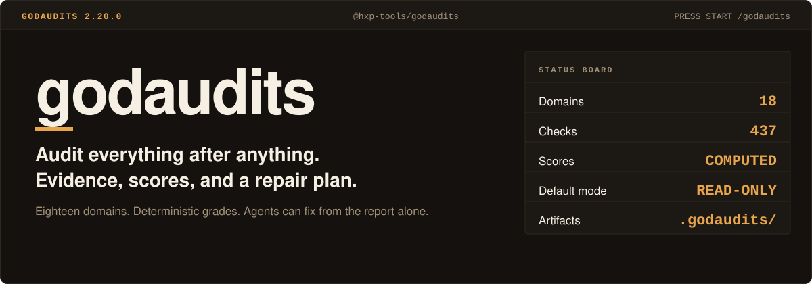
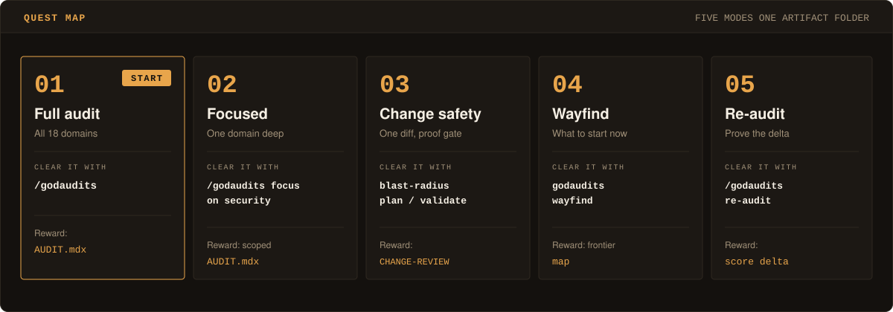
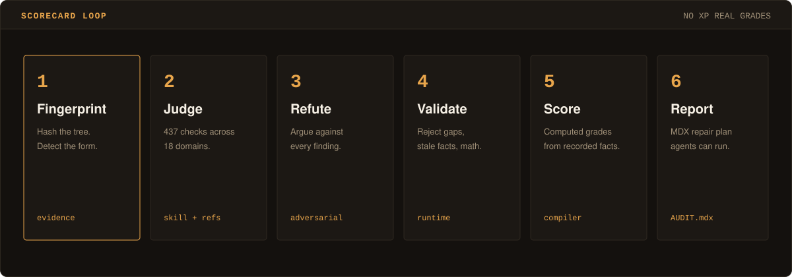

<p align="center">
  
</p>

<p align="center">
  <a href="https://github.com/hannsxpeter/godaudits/actions/workflows/lint.yml"></a>
  <a href="https://www.npmjs.com/package/@hxp-tools/godaudits"></a>
  <a href="CHANGELOG.md"></a>
  <a href="skills/godaudits/SKILL.md"></a>
  <a href="LICENSE"></a>
</p>

<h3 align="center">Audit everything after anything.</h3>

<p align="center"><em>You ask. The auditor scores. Another agent can fix from the report alone.</em></p>

godaudits is an evidence-first codebase audit for AI coding agents. It fingerprints
a repository, grades it across 18 domains (437 checks), refuses unverified merge
safety, and hands back a repair plan detailed enough for another agent to execute.
Sibling of [godpowers](https://github.com/hannsxpeter/godpowers). Part of
[`@hxp-tools`](https://www.npmjs.com/org/hxp-tools).

---

## Press start

```bash
npx @hxp-tools/godaudits@latest doctor
# or install the skill into your harnesses:
npx skills add hannsxpeter/godaudits
# or from source:
git clone https://github.com/hannsxpeter/godaudits
cd godaudits && sh install.sh
```

Then, inside your agent, clear the first level:

| Host | First run |
|---|---|
| Claude Code, Cursor, VS Code, Factory | `/godaudits` |
| Codex | `$godaudits` |
| Windsurf | `@godaudits` |

Everything lands in `.godaudits/`. Static mode never runs your app, your tests,
or the network.

### Claude Code plugin (alternative)

```text
/plugin marketplace add hannsxpeter/godaudits
/plugin install godaudits@godaudits
```

---

## The quest map

Five modes. Run the ones that match the question you are asking. Each writes
artifacts under `.godaudits/`.

<p align="center">
  
</p>

| Level | Clear it with | Reward |
|---|---|---|
| 1. Full audit | `/godaudits` | `AUDIT.mdx` + `AUDIT.json` |
| 2. Focused | `/godaudits focus on security` | scoped report |
| 3. Change safety | `godaudits blast-radius ...` | `CHANGE-REVIEW.mdx` |
| 4. Wayfind | `godaudits wayfind .godaudits/AUDIT.json` | frontier map |
| 5. Re-audit | `/godaudits` after repairs | score and coverage delta |

The game layer is a map, not a scoreboard. There are no points or XP. The real
grades are the numeric scores the runtime computes from recorded outcomes.

<details>
<summary>What the 18 domains cover</summary>

| Area | Question | Checks |
|---|---|---:|
| Product | Does it do what it promises? | 21 |
| Architecture | Do the pieces fit under load? | 29 |
| Stack | Are the technologies still the right bet? | 24 |
| Database | Is data modeled, indexed, and protected? | 24 |
| Security | Can it be broken into or abused? | 33 |
| AI integration | Are model calls safe and evaluated? | 25 |
| User experience | Do the real journeys work? | 22 |
| Interface | Is the UI accessible and finished? | 24 |
| Search visibility | Can search and answer engines find it? | 25 |
| Code quality | Is it readable, tested, and safe to change? | 26 |
| Style consistency | Does new code match the neighborhood? | 23 |
| Agent memory | Do AI instruction files actually load? | 24 |
| Repository | Is the project set up for others? | 24 |
| Build completeness | Is anything stubbed or faked? | 22 |
| Roadmap | Is the sequence coherent and honest? | 23 |
| Deployment | Can it ship and roll back? | 21 |
| Observability | Would you know when it breaks? | 24 |
| Launch readiness | Is it ready for the public? | 23 |

Per-check detail: [`docs/CHECK-MAP.md`](docs/CHECK-MAP.md).

</details>

---

## Scorecard loop

<p align="center">
  
</p>

The model does judgment. The bundled runtime does inventory, validation, score
arithmetic, rendering, and diffs. Unknown stays visible and caps the grade.
Secrets are masked. More on the split: [`docs/ABOUT.md`](docs/ABOUT.md).

**What you get**

| File | What it is |
|---|---|
| `AUDIT.mdx` | Readable report and repair plan |
| `AUDIT.json` | Source of truth for every check, finding, task, and score |
| `EVIDENCE.json` | Repository fingerprint with hashes |
| `AUDIT.sarif` | Optional host annotations |
| `CHANGE-REVIEW.*` | Diff-scoped safety facts and merge gate |
| `archive/` | Previous audits for deltas |

---

## Why the grade holds

- Nothing unexamined counts as fine. Unknowns reduce coverage and cap the verdict.
- Findings point at file and line with content hashes.
- Scores are compiled from recorded outcomes and published weights.
- Candidates are refuted before they ship; symptoms cluster under one root cause.
- Change safety needs executable proof before the merge gate can pass.
- Accuracy, including misses, is published in [`ACCURACY.md`](ACCURACY.md).

---

## Under the hood

```bash
godaudits doctor
godaudits evidence . --output .godaudits/EVIDENCE.json
godaudits init --name my-project --output .godaudits/AUDIT.json
godaudits validate .godaudits/AUDIT.json --repo . --write
godaudits render .godaudits/AUDIT.json --output .godaudits/AUDIT.mdx
godaudits wayfind .godaudits/AUDIT.json
godaudits blast-radius validate .godaudits/CHANGE-REVIEW.json
```

Runtime lives inside the skill (`skills/godaudits/runtime/`). Node 22+.
Change-safety contract:
[`skills/godaudits/references/change-safety.md`](skills/godaudits/references/change-safety.md).
Council review (opt-in):
[`skills/godaudits/guides/council.md`](skills/godaudits/guides/council.md).

Portable prompts for tools without skills: `PROMPT.md` (compact) and
`PROMPT.full.md` (all 18 modules).

godaudits mirrors [godplans](https://github.com/hannsxpeter/godplans): plan
requirement `R-SEC-3` pairs with audit check `A-SEC-3`.

---

## Docs

| Path | Role |
|---|---|
| [`docs/ABOUT.md`](docs/ABOUT.md) | Judgment vs determinism |
| [`docs/ENGINE.md`](docs/ENGINE.md) | Runtime invariants |
| [`docs/CHECK-MAP.md`](docs/CHECK-MAP.md) | Every check by domain |
| [`docs/EVALUATION.md`](docs/EVALUATION.md) | Benchmark methodology |
| [`docs/WAYFINDING.md`](docs/WAYFINDING.md) | Frontier and fog |
| [`docs/THREAT-MODEL.md`](docs/THREAT-MODEL.md) | Auditor safety |
| [`docs/RELEASE-POLICY.md`](docs/RELEASE-POLICY.md) | Release cadence |
| [`docs/MIGRATION-2.17.md`](docs/MIGRATION-2.17.md) | Evidence schema 1.1 to 1.2 |
| [`ACCURACY.md`](ACCURACY.md) | Published misses and false positives |
| [`CHANGELOG.md`](CHANGELOG.md) | Release history |

## Development

```bash
npm test
npm run check
npm run release:check
```

## License

[MIT](LICENSE). Third-party attributions in [`NOTICE`](NOTICE).
