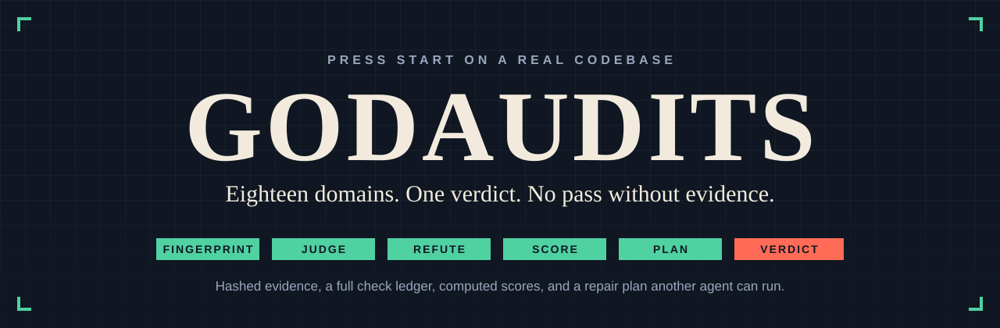
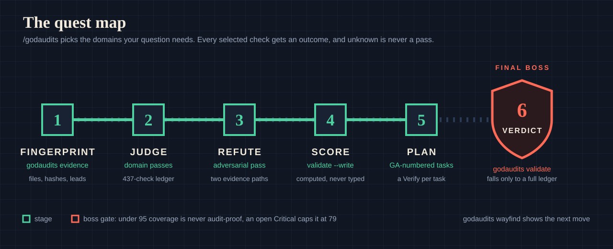
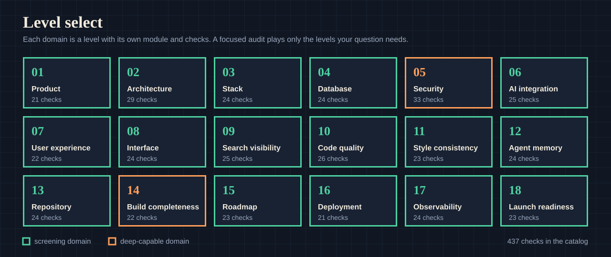
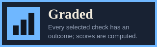

<p align="center">
  
</p>

[](https://www.npmjs.com/package/@hxp-tools/godaudits)
[](https://github.com/hannsxpeter/godaudits/actions/workflows/lint.yml)
[](LICENSE)

godaudits turns auditing an existing codebase with an AI coding agent into a
quest with rules. The model does the judging. godaudits adds the four things a
model cannot do for itself: a hashed fingerprint of the repository taken before
any opinion, a ledger where every selected check gets an outcome and unknown is
never a pass, scores computed from those outcomes instead of typed, and a
repair plan precise enough that another agent can execute it from the report
alone. Nothing counts as fine until the evidence says so.

It is one skill with a bundled, zero-dependency runtime: 18 domains and 437
checks. Static mode is the default, so it never runs your app, your tests, or
the network.

## Press start

```bash
npx skills add hannsxpeter/godaudits
```

That installs the skill for the coding tools it finds. From a clone,
`sh install.sh` does the same with more control: `--project` installs into the
current project, `--tools claude,agents` picks hosts, and `--uninstall` removes
exactly what it installed.

Claude Code can also install it as a plugin (the command is namespaced, for
example `/godaudits:godaudits`):

```text
/plugin marketplace add hannsxpeter/godaudits
/plugin install godaudits@godaudits
```

Pick one install method per host. Then, in a repository, ask for the audit:

```text
/godaudits focus on security
```

In Codex the command is `$godaudits`; in Windsurf it is `@godaudits`. Plain
`/godaudits` runs a focused audit on the domains your repository's risk points
to. Ask for full-project due diligence when you want all eighteen.

## The quest map

<p align="center">
  
</p>

| Stage | What happens |
| --- | --- |
| Fingerprint | `godaudits evidence` inventories manifests, languages, files, and content hashes, plus high-signal leads and recorded absences. No opinion yet. |
| Judge | Each selected domain is read from its own module, ideally in a fresh context, and every one of its checks gets an outcome with evidence. |
| Refute | Every candidate finding is argued against: re-open the cited code, trace it to the sink, look for the guard. What does not survive is dropped or downgraded. |
| Score | `godaudits validate --write` compiles coverage, domain scores, and caps from the recorded outcomes. Nobody types a number. |
| Plan | Findings become GA-numbered tasks with files, dependencies, acceptance conditions, and one exact Verify command each. |
| Verdict | The validator has to pass on a complete ledger before the report renders. See [the final boss](#the-final-boss-the-verdict). |

## Level select

<p align="center">
  
</p>

Every domain gets an applicability row. One that does not apply is excluded
with the reason, so a command-line tool does not get a hollow search-visibility
score. Per-check detail is in [docs/CHECK-MAP.md](docs/CHECK-MAP.md).

| Mode | When | What you get |
| --- | --- | --- |
| Focused | The default, or `/godaudits focus on <domain>` | A scoped `AUDIT.mdx` that never claims to be a full-project score |
| Full | You ask for full-project due diligence | All eighteen domains, screening and deep-trace checks |
| Re-audit | `.godaudits/AUDIT.json` already exists | Ids and history kept, plus a score and coverage delta |
| Change safety | You ask what a diff could break | `CHANGE-REVIEW.mdx` with a proof-gated merge verdict |
| Wayfind | `godaudits wayfind .godaudits/AUDIT.json` | The open tasks you can take now, what blocks the rest, and the fog |

There are no sub-commands to memorize. The mode comes from what is on disk and
what you ask.

## Achievements

An achievement is an outcome the runtime computes. None of them can be claimed
by editing a report.

<p align="center">
  
  
  
  
</p>

| Achievement | Earned by |
| --- | --- |
| Fingerprinted | `godaudits evidence` writes `EVIDENCE.json` with file hashes before any domain pass |
| Graded | `godaudits validate --write` passes: every selected check has an outcome and the scores are compiled |
| Audit-proof | The compiled verdict is 90 or higher, which coverage under 95 or an open Critical rules out |
| Merge-safe | `godaudits blast-radius validate` returns `pass`: every safety fact and the before-merge reproduction reached executable proof |

Graded and Audit-proof grade the audit as recorded. They are only as good as
the judgment behind each outcome; see [Limits](#limits).

## The final boss: the verdict

The verdict is computed, and it only falls to a complete ledger. The validator
refuses to compile when a catalog check is missing, a weight is wrong, evidence
is missing or unredacted, a Critical or High finding has no task, or the task
graph has a cycle. When it does compile, the caps are fixed:

| Condition | Cap |
| --- | --- |
| Coverage 80 to 94 | Overall at 89, so never audit-proof |
| Coverage 60 to 79 | Overall at 79 |
| Coverage below 60 | Overall at 69 |
| An active Critical, including an accepted risk | Its domain at 69, overall at 79 |
| Any domain below 50 | Overall at 84 |

Bands: 90 to 100 audit-proof, 80 to 89 solid, 70 to 79 needs work, 50 to 69 at
risk, 0 to 49 critical condition. A score without coverage is invalid.

Change safety has its own boss. A blast-radius review is `blocked` by a refuted
fact, a failed reproduction, or an open High or Critical consequence; it is
`unproven` while any fact stops below level 4 (executable proof against the
shipped code). Only `pass` is merge-ready. The contract is in
[change-safety.md](skills/godaudits/references/change-safety.md).

## Your save file

Everything lands in `.godaudits/`:

- `AUDIT.json`: the source of truth for every check, finding, task, and score.
- `AUDIT.mdx`: the readable report and repair plan, generated, never hand-edited.
- `EVIDENCE.json`: the repository fingerprint with hashes.
- `AUDIT.sarif`: optional annotations for your code host.
- `CHANGE-REVIEW.json` and `CHANGE-REVIEW.mdx`: diff-scoped safety facts and the merge gate.
- `archive/`: previous audits, so a re-audit can show the delta.

## CLI at a glance

The skill calls the runtime for you. You can run it directly too, with
`npx @hxp-tools/godaudits <cmd>` or `node skills/godaudits/runtime/godaudits.js
<cmd>` from a clone. Node 22 or newer.

```text
godaudits doctor                                            Node, catalog, and schema health
godaudits evidence . --output .godaudits/EVIDENCE.json
godaudits init --name <slug> --scale <scale> --applicable security,build \
  --evidence .godaudits/EVIDENCE.json --output .godaudits/AUDIT.json
godaudits validate .godaudits/AUDIT.json --repo . --write    compile scores and caps
godaudits render .godaudits/AUDIT.json --output .godaudits/AUDIT.mdx
godaudits sarif .godaudits/AUDIT.json --output .godaudits/AUDIT.sarif
godaudits diff <previous.json> <current.json>               re-audit delta
godaudits wayfind .godaudits/AUDIT.json                     frontier, blocked, fog
godaudits blast-radius plan|validate|apply|render ...       change safety
godaudits council plan|apply|triage|render ...              opt-in cross-harness review
```

Scanner output (SARIF, Semgrep, ast-grep, Gitleaks, OSV-Scanner) imports as
leads with `import-sarif` and `import-tool`, never as findings. The opt-in
council is in [guides/council.md](skills/godaudits/guides/council.md). Tools
without skill support can use `PROMPT.md` (compact) or `PROMPT.full.md` (all 18
modules).

godaudits pairs with [godplans](https://github.com/hannsxpeter/godplans): plan
requirement `R-SEC-3` is audit check `A-SEC-3`. Both sit beside
[godpowers](https://github.com/hannsxpeter/godpowers) and
[goddesign](https://github.com/hannsxpeter/goddesigns) in
[`@hxp-tools`](https://www.npmjs.com/org/hxp-tools).

## Limits

- The runtime never decides whether a signal is a finding. Outcomes are the
  model's judgment; the runtime checks their shape, evidence, and arithmetic.
- Static evidence does not certify that a vulnerability is absent. Stronger
  modes (sandbox, connected) need your explicit authority.
- Security and build completeness are deep-capable; the other sixteen domains
  are screening. A depth label is never a certification.
- A council can lower a finding's confidence and never raise it. Its seat
  scores are shown and never gate a verdict.

## Honest status

**Installing the skill has not yet been shown to make a model better at
auditing.**

The one complete controlled experiment measured zero lift on small seeded
cases that both arms solved perfectly, at about twice the tokens. The one
audit of a real open-source project with a known CVE recorded a miss: it found
the general weakness and not the advisory's exploit path. Seventeen of eighteen
domains have no completed measurement. All of it, misses included, is in
[ACCURACY.md](ACCURACY.md) and [dogfood/](dogfood/README.md). If you run it on
a codebase with known issues, share the numbers, especially the bad ones.

## More

- [About: judgment vs determinism](docs/ABOUT.md)
- [Engine invariants](docs/ENGINE.md)
- [Check map](docs/CHECK-MAP.md)
- [Evaluation](docs/EVALUATION.md)
- [Wayfinding](docs/WAYFINDING.md)
- [Threat model](docs/THREAT-MODEL.md)
- [Release policy](docs/RELEASE-POLICY.md)
- [Contributing](CONTRIBUTING.md)
- [Security](SECURITY.md)
- [Changelog](CHANGELOG.md)

[MIT](LICENSE). Third-party attributions in [NOTICE](NOTICE).
